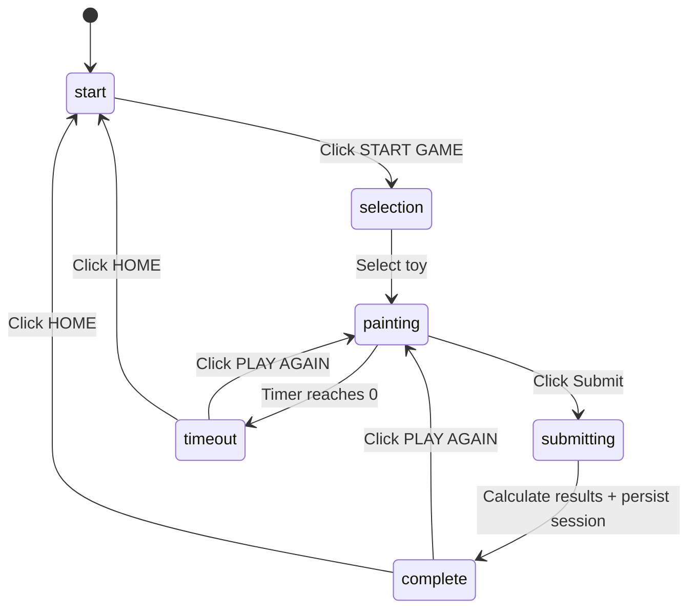
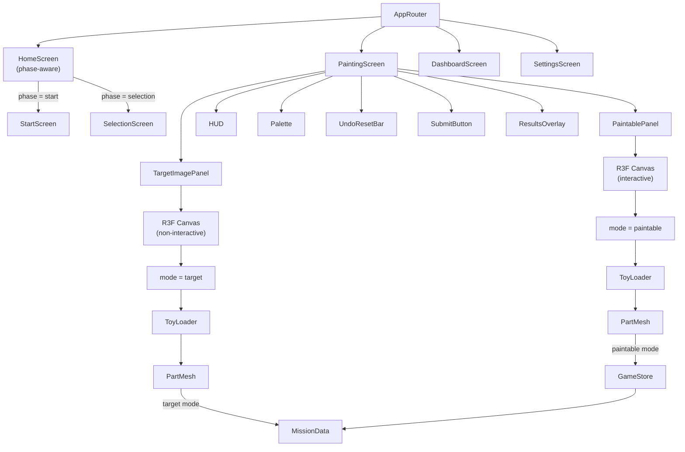

# Design Document: Target Colouring Challenge

## Overview

This feature redesigns the existing TOYVERSE game from a free-painting sandbox into a structured Target Image Based 3D Toy Colouring Challenge. The core gameplay loop changes from "load a toy with pre-applied colours and paint freely" to "see a target reference image, paint a neutral 3D toy to match it, and get scored on colour accuracy against a countdown timer."

The redesign reuses the existing React, TypeScript, Three.js, React Three Fiber (R3F), and Zustand architecture. Existing toy models, routes, dashboard, achievements, and i18n infrastructure are preserved. The primary changes are:

1. A new phase state machine adding `start` and `submitting` phases
2. A Start Screen with a START GAME button preceding toy selection
3. A non-interactive Target Image rendered alongside the paintable 3D toy using a render-mode context
4. Neutral (#CCCCCC) default colours for all toy parts
5. End-of-session scoring replacing incremental per-paint scoring
6. A Submit button for manual challenge completion
7. A Results Screen with per-part colour comparison
8. Removal of automatic mission completion from the paint loop

## Architecture

### Existing Architecture

The application is a single-page React app built with Vite. Key layers:

- **State Management**: Zustand store (`GameStore` in `src/store/gameStore.ts`) holds all application state including phase, part colours, timer, score, and session history
- **3D Rendering**: React Three Fiber (R3F) wraps Three.js. `WorkshopCanvas` hosts the WebGL context with camera, lighting, and orbit controls. `ToyLoader` lazy-loads toy model components. `PartMesh` renders individual paintable parts with hover glow and click-to-paint interaction
- **Routing**: React Router with four routes (`/` Home, `/paint/:toyId` Painting, `/dashboard` Dashboard, `/settings` Settings)
- **i18n**: Custom translation module (`src/i18n/`) supporting English and Tamil with English fallback
- **Data**: `MissionData` (`src/missions/missionData.ts`) defines target colours and durations per toy. `ToyRegistry` maps toy IDs to definitions and lazy-loaded components

### Phase State Machine

The phase state machine gains two new states: `start` (initial landing) and `submitting` (transient calculation phase between `painting` and `complete`).



### Component Architecture



### Dual-Canvas Design with Render-Mode Context

The key architectural addition is the `ToyRenderModeContext`, which allows the same toy model components to render in two modes:

- **Paintable mode** (default): `PartMesh` reads colours from `GameStore.partColors` with `#CCCCCC` fallback, attaches pointer event handlers for hover and click-to-paint
- **Target mode**: `PartMesh` reads colours from `MissionData.targets` by matching `partName`, renders without pointer event handlers, producing a non-interactive reference image

This approach keeps the geometry definition DRY — the same model files (`RacingCar.tsx`, `Robot.tsx`, etc.) serve both canvases. The render mode is determined by which `ToyRenderModeProvider` wraps the `ToyLoader`.

The Painting Screen uses two separate R3F Canvas elements:

1. **Target Image Canvas** (left on desktop, top on mobile): Smaller, non-interactive, auto-rotating. Renders the toy with `MissionData` target colours. The canvas DOM element has `pointer-events: none` to block all interaction.
2. **Paintable Canvas** (right on desktop, bottom on mobile): Full interactive canvas with `OrbitControls`, painting, and hover glow. Reads colours from `GameStore.partColors` with neutral fallback.

Responsive behaviour is handled via CSS flexbox:

- Wide screens (>=768px): `flex-direction: row`, target image takes ~35% width
- Mobile (<768px): `flex-direction: column`, target image takes a fixed height on top

### Scoring Model Change

The current scoring model is incremental: each `paintPart` call adjusts the score (+10 for correct, -5 for incorrect) and checks for mission completion. The redesigned model is end-of-session: no score is accumulated during painting. When the challenge ends (via submit or timer expiry), all parts are compared against their target colours in a single pass:

- `correctParts` = count of parts where `paintedColour.toUpperCase() === targetColour.toUpperCase()`
- `Colour_Accuracy` = `Math.round((correctParts / totalParts) * 100)`
- `Score` = `Colour_Accuracy` (they are the same value)
- `timeTaken` = `challengeDuration - remainingSeconds`

This means `paintPart` no longer modifies the score, checks for completion, or triggers phase transitions. The `MissionEngine.evaluatePaint` function is retained but no longer triggers phase transitions.

## Components and Interfaces

### New Components

#### StartScreen
- **Location**: `src/ui/screens/StartScreen.tsx`
- **Responsibility**: Renders the initial landing view with a START GAME button and navigation links to Dashboard and Settings
- **Renders when**: `phase === 'start'`
- **Key interaction**: Calls `startGame()` on START GAME click, transitioning phase to `selection`
- **Navigation**: Links to `/dashboard` and `/settings` routes

#### SelectionScreen
- **Location**: `src/ui/screens/SelectionScreen.tsx`
- **Responsibility**: Displays five selectable toys with localized labels and icons. On toy select, calls `selectToy(toyId)` which loads the mission from MissionData, reads the custom timer duration from localStorage, resets all challenge state, and transitions to `painting`
- **Renders when**: `phase === 'selection'`
- **Key interaction**: `selectToy(toyId)` — navigates to `/paint/:toyId`, loads mission, sets timer, resets state
- **Navigation**: Links to `/dashboard` and `/settings` routes

#### TargetImagePanel
- **Location**: `src/ui/components/TargetImagePanel.tsx`
- **Responsibility**: Hosts a non-interactive R3F Canvas that renders the selected toy with target colours from MissionData. Auto-rotates for visual appeal. The canvas DOM element has `pointer-events: none` and no OrbitControls.
- **Props**: `toyId: ToyId`
- **Wraps**: `ToyRenderModeProvider value="target"` around a simplified R3F Canvas containing `EnvironmentSetup`, an auto-rotating camera component, and `ToyLoader`

#### SubmitButton
- **Location**: `src/ui/components/SubmitButton.tsx`
- **Responsibility**: Displays a visible Submit button during the painting phase. Disabled during `submitting`, `complete`, and `timeout`. Calls `submitChallenge()` on click.
- **Visibility**: Visible during `painting` and `submitting`, hidden during `start`, `selection`, `complete`, `timeout`
- **Key interaction**: `submitChallenge()` — stops timer, transitions to `submitting`, calculates results, persists session, transitions to `complete`

#### ResultsOverlay
- **Location**: `src/ui/components/ResultsOverlay.tsx`
- **Responsibility**: End-of-challenge results display. Shows score, accuracy, correct/incorrect parts counts, time taken, star rating (via `StarRating` component), per-part colour comparison table, completed toy render, and PLAY AGAIN / HOME buttons.
- **Renders when**: `phase === 'complete'` or `phase === 'timeout'`
- **Key interactions**: `resetChallenge()` (PLAY AGAIN — same toy, fresh challenge), `goHome()` (HOME — navigate to start screen)
- **Per-part comparison**: For each part in the toy definition, displays the localized part label, a target colour swatch (from MissionData), a painted colour swatch (from partColors or #CCCCCC), and a correct/incorrect indicator

### Modified Components

#### PartMesh (`src/toys/PartMesh.tsx`)
- Reads `ToyRenderModeContext` to determine rendering mode
- In target mode: reads colour from `activeMission.targets` by matching `partName`, renders the mesh without pointer event handlers (no `onPointerOver`, `onPointerOut`, `onPointerDown`)
- In paintable mode: unchanged behaviour — reads colour from `GameStore.partColors[partName]` with `defaultColor` fallback, attaches pointer handlers for hover and painting
- The `useEffect` that applies colour to the material remains for both modes

#### GameStore (`src/store/gameStore.ts`)
- **Phase type**: extended to `'start' | 'selection' | 'painting' | 'submitting' | 'complete' | 'timeout'`
- **Initial phase**: `'start'` (was `'selection'`)
- **New actions**:
  - `startGame()`: transitions `start` to `selection`
  - `submitChallenge()`: transitions `painting` to `submitting`, calls `calculateResults()` and `endSession()`, then transitions to `complete`
  - `calculateResults()`: compares all parts against targets, sets `score`, `correctParts`, `incorrectParts`, `timeTaken`, evaluates end-of-session achievements
  - `resetChallenge()`: resets challenge state for the same toy, transitions to `painting`
  - `goHome()`: resets all state, transitions to `start`
- **Modified actions**:
  - `selectToy(toyId)`: now handles mission loading (absorbs `startMission`), reads custom timer duration from localStorage, performs full state reset, transitions to `painting`
  - `paintPart(partName, color)`: no longer modifies score, no longer checks for mission completion, no longer triggers phase transitions. Still records `PaintAction`, updates `partColors`, tracks `colorsUsedThisSession`, evaluates in-painting achievements (first-stroke, colour-explorer)
  - `tickTimer()`: on timeout, calls `calculateResults()` and `endSession()` instead of just setting phase
  - `endSession()`: creates `SessionResult` with end-of-session scoring fields, persists to localStorage, evaluates toy-master achievement
- **Removed**: `startMission()` (absorbed into `selectToy`), `correctPaints` and `totalMissionPaints` fields (replaced by `correctParts`, `incorrectParts`, `timeTaken`)
- **Achievement conditions**: updated for new scoring model (perfect-painter checks `correctParts > 0 && incorrectParts === 0`)

#### Toy Model Files (RacingCar, Robot, Dinosaur, Rocket, Aeroplane)
- All `defaultColor` props on `PartMesh` instances change from their current target colours to `#CCCCCC` (Neutral_Colour)
- All `defaultColor` values in the exported `ToyDefinition` parts arrays change to `#CCCCCC`
- Geometry, positions, rotations, and scales remain unchanged

#### PaintingScreen (`src/ui/screens/PaintingScreen.tsx`)
- Renders `TargetImagePanel` alongside `WorkshopCanvas` in a responsive flex layout
- Adds `SubmitButton` to the overlay
- Replaces the inline results overlay with `ResultsOverlay` component
- Timer tick logic preserved; scoring hooks removed (no longer reads `correctPaints`/`totalMissionPaints`)
- Window blur/focus timer pause/resume preserved

#### HomeScreen (`src/ui/screens/HomeScreen.tsx`)
- Becomes phase-aware: renders `StartScreen` when `phase === 'start'`, `SelectionScreen` when `phase === 'selection'`
- No longer resets to `selection` phase on mount (initial phase is `start`)

#### HUD (`src/ui/components/HUD.tsx`)
- Removes incremental score and accuracy display (score is end-of-session only)
- Removes inline mission target hints (Target Image Panel replaces these)
- Keeps timer display with low-time warning state (red, pulsing under 30s)

#### MissionEngine (`src/missions/MissionEngine.ts`)
- `evaluatePaint()` no longer checks for mission completion
- Retained for potential scoring utilities but the `isComplete` field always returns `false` or is removed
- No longer triggers phase transitions

### Preserved Components (No Changes)

- **DashboardScreen**: Reads session history from localStorage, displays stats and achievements
- **SettingsScreen**: Language toggle and timer duration slider (30-600s). The timer duration range already exists and is stored in localStorage as `toyverse_timer_duration`
- **Palette**: 12-colour palette with red (#FF0000) pre-selected
- **UndoResetBar**: Undo and reset with confirmation dialog
- **StarRating**: Renders 0-3 stars
- **AchievementToast**: 3-second achievement notification
- **LanguageToggle**: English/Tamil toggle
- **WorkshopCanvas**: R3F Canvas host with camera, lighting, and orbit controls
- **ToyLoader**: Lazy-loads toy components with error boundary
- **PaintHistory**: Pure data structure for undo stack
- **PaintingController**: Hook for paint click handling
- **PartHighlight**: Hover glow hook
- **colorUtils**: Colour comparison utilities (`colorsMatch`)
- **mathUtils**: `formatTimer`, `computeStarRating`, `clamp`
- **storageUtils**: Safe localStorage access
- **i18n**: Translation module (new keys added, module structure unchanged)

## Data Models

### Type Changes (`src/store/types.ts`)

```typescript
// Phase type — adds 'start' and 'submitting'
export type Phase = 'start' | 'selection' | 'painting' | 'submitting' | 'complete' | 'timeout';

// GameActions — new actions, startMission removed
export interface GameActions {
  // Existing (modified)
  selectToy: (toyId: ToyId) => void;
  paintPart: (partName: string, color: string) => void;
  undoPaint: () => void;
  resetPainting: () => void;
  setActiveColor: (color: string) => void;
  tickTimer: () => void;
  pauseTimer: () => void;
  resumeTimer: () => void;
  endSession: () => void;
  setLocale: (locale: Locale) => void;
  showAchievementToast: (id: AchievementId) => void;
  dismissAchievementToast: () => void;
  setStorageWarning: (val: boolean) => void;
  showNoPalettePromptAction: () => void;
  dismissNoPalettePrompt: () => void;

  // New
  startGame: () => void;
  submitChallenge: () => void;
  calculateResults: () => void;
  resetChallenge: () => void;
  goHome: () => void;

  // Removed
  // startMission: (mission: Mission) => void;
}

// GameStateData — scoring fields changed
export interface GameStateData {
  activeToyId: ToyId | null;
  activeMission: Mission | null;
  phase: Phase;
  partColors: Record<string, string>;
  activeColor: string | null;
  paintHistory: PaintAction[];
  showNoPalettePrompt: boolean;

  // Scoring (end-of-session)
  score: number;           // = Colour_Accuracy (0-100)
  correctParts: number;    // Part_Match count
  incorrectParts: number;  // non-matching count
  timeTaken: number;       // seconds: challengeDuration - remainingSeconds

  remainingSeconds: number;
  timerRunning: boolean;
  unlockedAchievements: AchievementId[];
  pendingAchievementToast: AchievementId | null;
  sessionHistory: SessionResult[];
  colorsUsedThisSession: string[];
  locale: Locale;
  storageWarning: boolean;

  // Removed:
  // correctPaints: number;
  // totalMissionPaints: number;
}
```

### Initial State

```typescript
const initialState: GameStateData = {
  activeToyId: null,
  activeMission: null,
  phase: 'start',          // was 'selection'
  partColors: {},
  activeColor: '#FF0000',
  paintHistory: [],
  showNoPalettePrompt: false,
  score: 0,
  correctParts: 0,         // was correctPaints
  incorrectParts: 0,       // new
  timeTaken: 0,            // new
  remainingSeconds: 120,
  timerRunning: false,
  unlockedAchievements: [],
  pendingAchievementToast: null,
  sessionHistory: [],
  colorsUsedThisSession: [],
  locale: readPersistedLocale(),
  storageWarning: false,
};
```

### SessionResult (unchanged structure)

```typescript
export interface SessionResult {
  toyId: ToyId;
  score: number;       // = Colour_Accuracy
  accuracy: number;    // = Colour_Accuracy (same as score)
  stars: 0 | 1 | 2 | 3;
  timestamp: number;
  achievementsUnlocked: AchievementId[];
}
```

### New: ToyRenderModeContext

```typescript
// src/toys/ToyRenderModeContext.ts
import { createContext } from 'react';

export type ToyRenderMode = 'paintable' | 'target';
export const ToyRenderModeContext = createContext<ToyRenderMode>('paintable');
export const ToyRenderModeProvider = ToyRenderModeContext.Provider;
```

### New: PartComparison (for ResultsOverlay)

```typescript
// Computed in ResultsOverlay from GameStore state
interface PartComparison {
  partName: string;
  partLabel: string;      // localized label from ToyDefinition
  targetColor: string;    // from MissionData
  paintedColor: string;   // from partColors or #CCCCCC fallback
  isMatch: boolean;        // case-insensitive hex comparison
}
```

### Scoring Logic (calculateResults)

```typescript
function calculateResults(state: GameStateData): Partial<GameStateData> {
  if (!state.activeMission || !state.activeToyId) return {};

  const toyDef = TOY_DEFINITIONS[state.activeToyId];
  const totalParts = toyDef.parts.length;

  let correctParts = 0;
  for (const target of state.activeMission.targets) {
    const painted = state.partColors[target.partName] ?? '#CCCCCC';
    if (painted.toUpperCase() === target.targetColor.toUpperCase()) {
      correctParts++;
    }
  }

  const accuracy = totalParts > 0
    ? Math.round((correctParts / totalParts) * 100)
    : 0;

  const timeTaken = Math.max(0,
    state.activeMission.durationSeconds - state.remainingSeconds
  );

  return {
    score: accuracy,
    correctParts,
    incorrectParts: totalParts - correctParts,
    timeTaken,
  };
}
```

### Star Rating (unchanged, from mathUtils)

```typescript
function starsFromScore(score: number): 0 | 1 | 2 | 3 {
  if (score >= 90) return 3;
  if (score >= 50) return 2;
  if (score >= 10) return 1;
  return 0;
}
```

### Achievement Conditions (updated for new scoring)

```typescript
const ACHIEVEMENT_DEFS: AchievementDefinition[] = [
  {
    id: 'first-stroke',
    nameKey: 'achievement.firstStroke.name',
    iconEmoji: '🎨',
    condition: (s) => s.paintHistory.length >= 1,
  },
  {
    id: 'speed-painter',
    nameKey: 'achievement.speedPainter.name',
    iconEmoji: '⚡',
    condition: (s) =>
      (s.phase === 'complete' || s.phase === 'timeout') &&
      s.remainingSeconds >= 60,
  },
  {
    id: 'perfect-painter',
    nameKey: 'achievement.perfectPainter.name',
    iconEmoji: '⭐',
    condition: (s) =>
      (s.phase === 'complete' || s.phase === 'timeout') &&
      s.correctParts > 0 &&
      s.incorrectParts === 0,
  },
  {
    id: 'colour-explorer',
    nameKey: 'achievement.colourExplorer.name',
    iconEmoji: '🌈',
    condition: (s) => s.colorsUsedThisSession.length >= 12,
  },
  {
    id: 'toy-master',
    nameKey: 'achievement.toyMaster.name',
    iconEmoji: '🏆',
    condition: (s) => {
      const completedToys = new Set(
        s.sessionHistory
          .filter((r) => r.stars > 0)
          .map((r) => r.toyId)
      );
      return completedToys.size >= 5;
    },
  },
];
```

### i18n New Keys

New translation keys are added to both `en.ts` and `ta.ts`:

| Key | English | Tamil |
|-----|---------|-------|
| `start.title` | TOYVERSE | டாய்வர்ஸ் |
| `start.startGame` | START GAME | விளையாட்டை தொடங்கு |
| `start.dashboard` | Dashboard | டாஷ்போர்டு |
| `start.settings` | Settings | அமைப்புகள் |
| `selection.title` | Choose Your Toy | உங்கள் விளையாட்டை தேர்வு செய் |
| `painting.submit` | SUBMIT | சமர்ப்பி |
| `painting.targetImage` | Target Image | இலக்கு படம் |
| `results.title` | Challenge Complete! | சவால் முடிந்தது! |
| `results.score` | Score | மதிப்பெண் |
| `results.accuracy` | Accuracy | துல்லியம் |
| `results.correctParts` | Correct Parts | சரியான பாகங்கள் |
| `results.incorrectParts` | Incorrect Parts | தவறான பாகங்கள் |
| `results.timeTaken` | Time Taken | எடுத்த நேரம் |
| `results.stars` | Stars | நட்சத்திரங்கள் |
| `results.playAgain` | PLAY AGAIN | மீண்டும் விளையாடு |
| `results.home` | HOME | முகப்பு |
| `results.partComparison` | Part Comparison | பாக ஒப்பீடு |
| `results.correct` | Correct | சரி |
| `results.incorrect` | Incorrect | தவறு |
| `results.timeout` | Time's Up! | நேரம் முடிந்தது! |
## Correctness Properties

*A property is a characteristic or behavior that should hold true across all valid executions of a system — essentially, a formal statement about what the system should do. Properties serve as the bridge between human-readable specifications and machine-verifiable correctness guarantees.*

This feature involves pure functions (scoring, star rating, colour comparison), state machine transitions, and data invariants that are well-suited for property-based testing. The project already includes `fast-check` (v3.14.0) as a dev dependency.

### Property 1: Phase transition from start to selection

*For any* GameStore state where `phase === 'start'`, calling `startGame()` SHALL transition `phase` to `'selection'` and change no other state fields.

**Validates: Requirements 1.3**

### Property 2: Toy selection initializes the challenge

*For any* valid `ToyId`, calling `selectToy(toyId)` SHALL set `activeToyId` to that id, load the corresponding `Mission` from `MissionData` as `activeMission`, set `phase` to `'painting'`, set `timerRunning` to `true`, clear `partColors` to `{}`, clear `paintHistory` to `[]`, reset `score` to 0, reset `correctParts` and `incorrectParts` to 0, reset `timeTaken` to 0, clear `colorsUsedThisSession` to `[]`, and set `remainingSeconds` to the configured challenge duration.

**Validates: Requirements 2.2, 2.3, 12.1, 12.2, 12.3, 12.4, 12.5, 12.6, 12.7, 12.8**

### Property 3: Paint isolation

*For any* GameStore state with any `partColors` record, any `activeColor`, and any part name `P`, calling `paintPart(P, activeColor)` SHALL only modify `partColors[P]`, leaving all other entries in `partColors` unchanged.

**Validates: Requirements 4.7**

### Property 4: Paint action recording

*For any* GameStore state and any paint operation on part `P` with colour `C`, the `PaintAction` appended to `paintHistory` SHALL contain `partName === P`, `newColor === C`, `previousColor` equal to the part's colour before painting (or `#CCCCCC` if unpainted), and a `timestamp` that is a positive number.

**Validates: Requirements 5.4, 5.10**

### Property 5: Undo round-trip

*For any* GameStore state with a non-empty `paintHistory`, calling `undoPaint()` SHALL restore the `partColors` entry for the most recently painted part to its `previousColor` value from the last `PaintAction`, remove that action from `paintHistory`, and leave all other `partColors` entries unchanged. Repeatedly calling `undoPaint()` until `paintHistory` is empty SHALL restore `partColors` to its initial empty state.

**Validates: Requirements 6.2**

### Property 6: Challenge state reset

*For any* GameStore state (including states with painted parts, non-zero score, and non-empty history), starting a new challenge via `selectToy()` or `resetChallenge()` SHALL reset `partColors` to `{}`, `paintHistory` to `[]`, `score` to 0, `correctParts` to 0, `incorrectParts` to 0, `timeTaken` to 0, `colorsUsedThisSession` to `[]`, and `remainingSeconds` to the configured challenge duration.

**Validates: Requirements 4.1, 4.3, 6.5, 11.12, 12.1, 12.2, 12.3, 12.4, 12.5, 12.6**

### Property 7: Reset cancel is a no-op

*For any* GameStore state, cancelling the reset confirmation SHALL leave `partColors` and `paintHistory` unchanged. (The UI cancel path does not call `resetPainting()`.)

**Validates: Requirements 6.6**

### Property 8: Timer duration selection

*For any* valid `ToyId` and any custom timer duration `D` in `[30, 600]` stored in localStorage, calling `selectToy(toyId)` SHALL set `remainingSeconds` to `D`. When no custom duration is configured, `remainingSeconds` SHALL equal the mission's default `durationSeconds` from `MissionData`.

**Validates: Requirements 7.1, 7.12**

### Property 9: Timer tick decrement

*For any* GameStore state where `phase === 'painting'`, `timerRunning === true`, and `remainingSeconds > 0`, calling `tickTimer()` SHALL decrement `remainingSeconds` by exactly 1 and not change `phase` or `timerRunning`.

**Validates: Requirements 7.4**

### Property 10: Timer expiry auto-end

*For any* GameStore state where `phase === 'painting'`, `timerRunning === true`, and `remainingSeconds === 1`, calling `tickTimer()` SHALL set `remainingSeconds` to 0, set `timerRunning` to `false`, set `phase` to `'timeout'`, calculate results (setting `score`, `correctParts`, `incorrectParts`, `timeTaken`), and add a `SessionResult` to `sessionHistory`.

**Validates: Requirements 7.9, 7.10, 9.1, 9.2, 9.3, 9.4**

### Property 11: Submit end transition

*For any* GameStore state where `phase === 'painting'`, calling `submitChallenge()` SHALL set `timerRunning` to `false`, transition `phase` to `'submitting'`, calculate results (setting `score`, `correctParts`, `incorrectParts`, `timeTaken`), add a `SessionResult` to `sessionHistory`, and then transition `phase` to `'complete'`.

**Validates: Requirements 8.2, 8.3, 8.4, 8.5, 8.9**

### Property 12: Colour accuracy scoring

*For any* set of painted colours (where unpainted parts are treated as `#CCCCCC`) and any set of mission targets, the `Colour_Accuracy` SHALL equal `Math.round((matchingParts / totalParts) * 100)` where a part matches when its painted colour equals its target colour using case-insensitive hex string comparison. `Score` SHALL equal `Colour_Accuracy`. `correctParts + incorrectParts` SHALL equal `totalParts`. When `totalParts === 0`, `Colour_Accuracy` SHALL be 0.

**Validates: Requirements 10.1, 10.2, 10.3, 10.4, 10.5, 10.6, 10.9**

### Property 13: Star rating calculation

*For any* score value in `[0, 100]`, `starsFromScore(score)` SHALL return 3 when `score >= 90`, 2 when `score >= 50`, 1 when `score >= 10`, and 0 otherwise.

**Validates: Requirements 10.7**

### Property 14: Time taken calculation

*For any* challenge with a configured duration `D` and `remainingSeconds` `R` at challenge end, `timeTaken` SHALL equal `Math.max(0, D - R)`.

**Validates: Requirements 10.8**

### Property 15: Target data separation

*For any* sequence of paint actions on any toy, the `MissionData` structure SHALL remain unchanged (its target colours and durations are never modified). The `partColors` record SHALL only contain colours that were explicitly painted by the player, never target colours from `MissionData`. The target image render SHALL always read colours from `MissionData`, not from `partColors`.

**Validates: Requirements 3.5, 3.6, 13.1, 13.2, 13.3, 13.5**

### Property 16: No automatic completion

*For any* sequence of paint actions where all parts eventually match their target colours, the `phase` SHALL remain `'painting'` and `timerRunning` SHALL remain `true` until the player calls `submitChallenge()` or the timer reaches zero. The `paintPart` action SHALL never transition `phase` or set `timerRunning` to `false`.

**Validates: Requirements 14.1, 14.2, 14.3**

### Property 17: Home transition

*For any* GameStore state, calling `goHome()` SHALL set `phase` to `'start'`, clear `activeToyId` to `null`, clear `activeMission` to `null`, and reset all challenge state fields (`partColors`, `paintHistory`, `score`, `correctParts`, `incorrectParts`, `timeTaken`, `colorsUsedThisSession`, `remainingSeconds`, `timerRunning`).

**Validates: Requirements 11.13**

### Property 18: MissionData completeness

*For any* valid `ToyId`, `MISSIONS[toyId].targets` SHALL contain an entry for every part name in `TOY_DEFINITIONS[toyId].parts`, and the number of targets SHALL equal the number of parts.

**Validates: Requirements 18.1, 18.8**

### Property 19: i18n fallback to English

*For any* translation key that exists in the English locale (`en`) but is missing from the Tamil locale (`ta`), calling `t(key, 'ta')` SHALL return the English value for that key.

**Validates: Requirements 16.6**

### Property 20: SessionResult structure

*For any* challenge that ends (via submit or timer expiry), the `SessionResult` added to `sessionHistory` SHALL contain `toyId` (matching `activeToyId`), `score` (matching the calculated `Colour_Accuracy`), `accuracy` (matching `score`), `stars` (computed from `score` via `starsFromScore`), a positive `timestamp`, and `achievementsUnlocked` as an array.

**Validates: Requirements 15.1**

## Error Handling

### Invalid Toy Selection
If the `toyId` route parameter does not match a valid `ToyId`, the PaintingScreen displays an error message with a link to navigate home. This behaviour is preserved from the existing implementation.

### No Active Colour
When the player clicks a 3D toy part without an active colour selected (`activeColor === null`), the `PartMesh` calls `showNoPalettePromptAction()` which displays a "no colour selected" prompt overlay. This behaviour is preserved. The prompt auto-dismisses when the player selects a colour.

### Timer Paused on Tab Blur
When the browser tab loses focus during the painting phase, `timerRunning` is set to `false` via the `pauseTimer()` action. The timer resumes when the tab regains focus via `resumeTimer()`. This prevents the challenge from ending while the player is away. This behaviour is preserved from the existing implementation.

### Custom Timer Duration Validation
The custom timer duration from Settings is clamped to `[30, 600]` seconds before being stored in localStorage. When `selectToy()` reads this value, it validates that it falls within `[30, 600]`; if the stored value is invalid or missing, it falls back to the mission's default `durationSeconds` (120).

### Storage Unavailable
If `localStorage` is unavailable (private browsing, SSR, or quota exceeded), the `safeGetItem` and `safeSetItem` utilities return `null` / `false` respectively. Session persistence and achievement persistence fail silently with a `storageWarning` flag set to `true`, which displays a warning banner. This behaviour is preserved.

### Zero-Part Toy (Degenerate Case)
If a toy definition has zero parts, `calculateResults()` defines `Colour_Accuracy` as 0 and `Score` as 0. This prevents a division-by-zero error. While no existing toy has zero parts, this is a safe default.

### i18n Missing Key
If a translation key is missing from the active locale, the i18n module falls back to the English translation and logs a console warning (once per key per locale to avoid log spam). If the key is also missing from English, the key itself is returned. This behaviour is preserved.

### Submit During Non-Painting Phase
The `submitChallenge()` action checks that `phase === 'painting'` before proceeding. If called during any other phase, it is a no-op. Additionally, the Submit button is disabled during `submitting`, `complete`, and `timeout` phases.

## Testing Strategy

### Dual Testing Approach

The feature uses both unit tests and property-based tests for comprehensive coverage:

- **Unit tests**: Verify specific examples, edge cases, UI rendering, and integration points
- **Property tests**: Verify universal properties across generated inputs using `fast-check`

### Property-Based Testing

PBT is appropriate for this feature because the core logic — scoring, state machine transitions, paint action recording, undo correctness, and data separation — involves pure functions and state invariants with large input spaces.

**Library**: `fast-check` v3.14.0 (already in devDependencies)

**Configuration**:
- Minimum 100 iterations per property test
- Each test tagged with: `Feature: target-colouring-challenge, Property {number}: {property_text}`
- Tests run via `vitest run` (single execution, no watch mode)

**Property test files** should be placed alongside existing test files and cover:

| Property | Test File | What Varies |
|----------|-----------|-------------|
| 1: Phase transition start→selection | `gameStore.test.ts` | Initial state |
| 2: Toy selection initializes challenge | `gameStore.test.ts` | ToyId (5 values) |
| 3: Paint isolation | `gameStore.test.ts` | partColors, activeColor, partName |
| 4: Paint action recording | `gameStore.test.ts` | State, partName, colour |
| 5: Undo round-trip | `gameStore.test.ts` | Sequence of paint actions |
| 6: Challenge state reset | `gameStore.test.ts` | Arbitrary state before reset |
| 7: Reset cancel no-op | `gameStore.test.ts` | Arbitrary state |
| 8: Timer duration selection | `gameStore.test.ts` | ToyId, custom duration |
| 9: Timer tick decrement | `gameStore.test.ts` | remainingSeconds |
| 10: Timer expiry auto-end | `gameStore.test.ts` | State at timer expiry |
| 11: Submit end transition | `gameStore.test.ts` | Painted parts, targets |
| 12: Colour accuracy scoring | `scoring.test.ts` | partColors, mission targets |
| 13: Star rating | `mathUtils.test.ts` | Score (0-100) |
| 14: Time taken | `scoring.test.ts` | Duration, remaining |
| 15: Target data separation | `gameStore.test.ts` | Paint action sequences |
| 16: No automatic completion | `gameStore.test.ts` | Paint sequences achieving all-match |
| 17: Home transition | `gameStore.test.ts` | Arbitrary state |
| 18: MissionData completeness | `missionData.test.ts` | ToyId (5 values) |
| 19: i18n fallback | `i18n.test.ts` | Translation keys |
| 20: SessionResult structure | `gameStore.test.ts` | Challenge end states |

**fast-check generators** needed:
- `fc.constantFrom(...TOY_IDS)` — generate valid ToyIds
- `fc.record({ partName: fc.string(), targetColor: fc.stringMatching(/#[0-9A-Fa-f]{6}/) })` — generate mission targets
- `fc.dictionary(fc.string(), fc.stringMatching(/#[0-9A-Fa-f]{6}/))` — generate partColors records
- `fc.array(paintActionArbitrary)` — generate paint histories
- `fc.integer({ min: 0, max: 600 })` — generate remaining seconds
- `fc.integer({ min: 0, max: 100 })` — generate scores

### Unit Tests

Unit tests focus on specific examples and edge cases:

**GameStore tests**:
- Initial state has `phase === 'start'`
- `startGame()` transitions to `selection`
- `selectToy()` for each of the 5 toys loads the correct mission
- `paintPart()` with `activeColor === null` triggers the no-palette prompt
- `undoPaint()` with empty history is a no-op
- `resetPainting()` clears partColors and paintHistory
- `tickTimer()` at `remainingSeconds === 1` transitions to timeout
- `submitChallenge()` transitions through submitting to complete
- `goHome()` resets to start phase
- `resetChallenge()` resets state and transitions to painting

**Scoring tests**:
- All parts correct → 100% accuracy, 3 stars
- No parts correct → 0% accuracy, 0 stars
- Half parts correct → 50% accuracy, 2 stars
- Unpainted parts treated as #CCCCCC
- Case-insensitive colour matching (#ff0000 matches #FF0000)
- Zero-part toy → accuracy = 0

**Component tests** (using @testing-library/react):
- StartScreen renders START GAME button
- SelectionScreen renders exactly 5 toy cards
- SubmitButton visible during painting, hidden during start/selection/complete/timeout
- SubmitButton disabled during submitting/complete/timeout
- ResultsOverlay renders per-part comparison with swatches
- ResultsOverlay renders PLAY AGAIN and HOME buttons
- HUD renders timer in MM:SS format
- Timer warning state at remainingSeconds < 30

**Configuration smoke tests**:
- All ToyDefinition `defaultColor` values are `#CCCCCC`
- All PartMesh `defaultColor` props in model files are `#CCCCCC`
- Palette has exactly 12 colours
- Default mission duration is 120 seconds
- MissionData targets match specified configurations (Req 18.2-18.6)
- i18n has all new keys in both `en` and `ta`
- Routes are correctly configured

### Integration Tests

Integration tests verify interactions with external systems:

- **localStorage persistence**: Session results persisted under `toyverse_sessions`, achievements under `toyverse_achievements`, locale under `toyverse_locale`, timer duration under `toyverse_timer_duration`
- **Window blur/focus**: Timer pauses on blur, resumes on focus during painting phase
- **Route navigation**: Unknown routes redirect to Home with not-found message
- **Dashboard**: Reads and displays session history from localStorage

### Test Execution

All tests run via `vitest run` (single execution, no watch mode):

```bash
npm test              # runs all tests
npm run typecheck     # TypeScript type checking
npm run build         # production build
```
