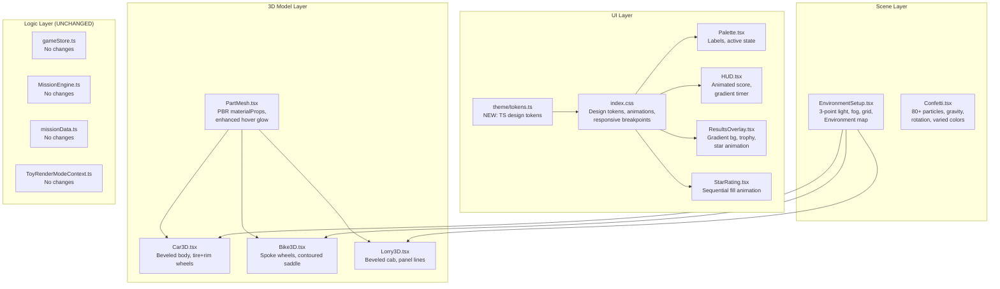

# Design Document: Toyverse Premium Upgrade

## Overview

This design covers a premium quality and visual upgrade of the existing Toyverse-3D toy painting game. The game already works end-to-end with React Three Fiber (R3F), Three.js, Zustand, and react-router-dom v6. This upgrade improves UI design polish, 3D model detail, lighting and materials, gameplay feedback, and completion animations **without breaking any existing game logic, routing, build, or deployment**.

The guiding principle is **additive enhancement**: every change either replaces visual/geometry code in-place (preserving the same component interfaces and part names) or adds new CSS/styling. No store actions, mission engine logic, routing, or persistence behavior changes.

### Key Design Decisions

| Decision | Rationale |
|----------|-----------|
| Add a centralized design tokens file (`src/ui/theme/tokens.ts`) | Single source of truth for colours, spacing, typography, shadows, and radii. Avoids scattered inline values. |
| Add PBR material props to PartMesh via optional `materialProps` | Preserves the existing PartMesh API (all current callers work unchanged) while allowing 3D models to specify per-part metalness/roughness. |
| Use `@react-three/drei` `Environment` for reflections | drei is already a dependency; `Environment` provides HDR-like PBR reflections without external assets. |
| Use `RoundedBoxGeometry` from drei for beveled shapes | Avoids custom geometry; drei exports `RoundedBox` which wraps `boxGeometry` with beveled edges. |
| CSS-only animations (keyframes + transitions) | No animation library needed; keeps bundle lightweight and Vercel-compatible. |
| `useAnimatedNumber` hook for HUD score count-up | Pure React hook using `requestAnimationFrame`; no new dependency. |
| Preserve all existing file paths and exports | Zero breaking changes to imports; build passes as-is. |

---

## Architecture

The upgrade touches four layers of the application. No new dependencies are introduced — all changes use existing packages (React 18, R3F, drei, Three.js, Zustand, react-router-dom v6).



### Data Flow (Unchanged)

The existing data flow is preserved entirely:

1. **PaintingScreen** reads `toyId` from URL params → calls `selectToy` on GameStore
2. **GameStore** loads the matching `Mission` from `MISSIONS` in `missionData.ts`
3. **WorkshopCanvas** renders the toy via `ToyLoader` → `ToyRenderModeProvider value="paintable"` → model component
4. **PartMesh** reads `ToyRenderModeContext` → in paintable mode, reads `partColors[partName]` from GameStore; in target mode, reads `activeMission.targets[partName]`
5. **PartMesh** onPointerDown → calls `paintPart(partName, activeColor)` on GameStore
6. **GameStore.paintPart** → calls `MissionEngine.evaluatePaint` → updates score, partColors, paintHistory
7. **GameStore.submitChallenge** → calls `calculateResults` → calls `endSession` → unlocks next level if ≥1 star

No changes to this flow. The upgrade only changes what gets rendered and how it looks.

---

## Components and Interfaces

### New File: `src/ui/theme/tokens.ts`

A TypeScript module exporting design tokens as both CSS custom property strings and typed objects.

```typescript
// src/ui/theme/tokens.ts

/** Colour palette tokens (Requirement 1.2) */
export const COLORS = {
  primary: '#FF6B35',
  secondary: '#4a90d9',
  success: '#4CAF50',
  danger: '#F44336',
  neutral: {
    cream: '#FFF7E8',
    sand: '#E8DDCA',
    dark: '#2D2D2D',
  },
  gold: '#FFD700',
  sceneBg: '#1a1a2e',
} as const;

/** Spacing scale in px (Requirement 1.3) */
export const SPACING = [4, 8, 12, 16, 24, 32] as const;

/** Font weights (Requirement 1.4) */
export const FONT_WEIGHTS = {
  body: 400,
  label: 600,
  emphasis: 700,
  heading: 800,
  hero: 900,
} as const;

/** Font stacks (Requirement 1.1) */
export const FONT_STACKS = {
  heading: "'Noto Sans Tamil', system-ui, -apple-system, sans-serif",
  body: "'Noto Sans Tamil', system-ui, -apple-system, BlinkMacSystemFont, 'Segoe UI', Roboto, sans-serif",
  mono: "'SF Mono', 'Cascadia Code', 'Courier New', monospace",
} as const;

/** Border radius (Requirement 2.5) */
export const RADIUS = { small: 8, panel: 12, large: 16 } as const;

/** Box shadow elevation levels (Requirement 2.6) */
export const SHADOWS = {
  level1: '0 1px 6px rgba(0,0,0,0.05)',
  level2: '0 2px 8px rgba(0,0,0,0.08)',
  level3: '0 4px 20px rgba(0,0,0,0.12)',
} as const;

/** Transition durations (Requirement 2.1-2.4) */
export const TRANSITIONS = {
  hover: '150ms',
  press: '100ms',
  overlay: '300ms',
  route: '200ms',
} as const;

/** Generates a CSS :root block string for injection into index.css */
export const CSS_VARIABLES = `
:root {
  --color-primary: ${COLORS.primary};
  --color-secondary: ${COLORS.secondary};
  --color-success: ${COLORS.success};
  --color-danger: ${COLORS.danger};
  --color-cream: ${COLORS.neutral.cream};
  --color-sand: ${COLORS.neutral.sand};
  --color-dark: ${COLORS.neutral.dark};
  --color-gold: ${COLORS.gold};
  --radius-small: ${RADIUS.small}px;
  --radius-panel: ${RADIUS.panel}px;
  --radius-large: ${RADIUS.large}px;
  --shadow-1: ${SHADOWS.level1};
  --shadow-2: ${SHADOWS.level2};
  --shadow-3: ${SHADOWS.level3};
  --font-heading: ${FONT_STACKS.heading};
  --font-body: ${FONT_STACKS.body};
  --font-mono: ${FONT_STACKS.mono};
}
` as const;
```

### Modified: `src/index.css`

Add design token CSS variables, animation keyframes, button hover/press states, overlay transitions, responsive breakpoint refinements.

```css
/* ===== Design Tokens (Requirement 1.1-1.4, 2.5-2.6) ===== */
:root {
  --color-primary: #FF6B35;
  --color-secondary: #4a90d9;
  --color-success: #4CAF50;
  --color-danger: #F44336;
  --color-cream: #FFF7E8;
  --color-sand: #E8DDCA;
  --color-dark: #2D2D2D;
  --color-gold: #FFD700;
  --radius-small: 8px;
  --radius-panel: 12px;
  --radius-large: 16px;
  --shadow-1: 0 1px 6px rgba(0,0,0,0.05);
  --shadow-2: 0 2px 8px rgba(0,0,0,0.08);
  --shadow-3: 0 4px 20px rgba(0,0,0,0.12);
  --font-heading: 'Noto Sans Tamil', system-ui, -apple-system, sans-serif;
  --font-body: 'Noto Sans Tamil', system-ui, -apple-system, BlinkMacSystemFont, 'Segoe UI', Roboto, sans-serif;
  --font-mono: 'SF Mono', 'Cascadia Code', 'Courier New', monospace;
  --space-1: 4px;
  --space-2: 8px;
  --space-3: 12px;
  --space-4: 16px;
  --space-5: 24px;
  --space-6: 32px;
}

/* ===== Button Interactions (Requirement 2.1-2.2) ===== */
.btn {
  transition: transform 150ms, filter 150ms, box-shadow 150ms;
}
.btn:hover {
  transform: scale(1.04);
  filter: brightness(1.08);
}
.btn:active {
  transform: scale(0.96);
  transition: transform 100ms;
}

/* ===== Overlay/Modal Animations (Requirement 2.3) ===== */
@keyframes overlay-enter {
  from { opacity: 0; transform: translateY(24px); }
  to   { opacity: 1; transform: translateY(0); }
}
.overlay-enter {
  animation: overlay-enter 250ms ease-out forwards;
}

/* ===== Route Transition (Requirement 2.4) ===== */
@keyframes screen-fade {
  from { opacity: 0; }
  to   { opacity: 1; }
}
.screen-fade {
  animation: screen-fade 200ms ease-out forwards;
}

/* ===== Flash animation for paint feedback (Requirement 10.3) ===== */
@keyframes paint-flash {
  0%   { filter: brightness(1.6); }
  100% { filter: brightness(1.0); }
}
.paint-flash {
  animation: paint-flash 300ms ease-out;
}

/* ===== Star fill animation (Requirement 13.4) ===== */
@keyframes star-fill {
  from { transform: scale(0) rotate(-180deg); opacity: 0; }
  to   { transform: scale(1) rotate(0deg); opacity: 1; }
}

/* ===== Score count-up (Requirement 11.1) ===== */
@keyframes score-pop {
  0%   { transform: scale(1); }
  50%  { transform: scale(1.15); color: var(--color-primary); }
  100% { transform: scale(1); }
}
.score-pop {
  animation: score-pop 400ms ease-out;
}

/* ===== Timer gradient zones (Requirement 11.2-11.4) ===== */
.timer-calm {
  background: #fff;
  color: var(--color-dark);
}
.timer-warning {
  background: linear-gradient(135deg, #FFD700, #FF8C42);
  color: #fff;
}
.timer-urgent {
  background: linear-gradient(135deg, #FF8C42, #FF4444);
  color: #fff;
  animation: pulse-timer 0.5s ease-in-out infinite alternate;
}

/* ===== Palette swatch active state (Requirement 9.3) ===== */
.palette-swatch.active {
  border: 4px solid var(--color-gold);
  transform: scale(1.12);
  box-shadow: 0 0 12px rgba(255,215,0,0.5), 0 2px 8px rgba(0,0,0,0.15);
}
.palette-swatch:hover {
  transform: scale(1.08);
  box-shadow: 0 2px 8px rgba(0,0,0,0.12);
}

/* ===== Responsive layout (Requirement 3.2-3.3) ===== */
@media (max-width: 768px) {
  .painting-main {
    flex-direction: column !important;
  }
  .painting-target-panel {
    width: 100% !important;
    height: 35% !important;
    border-right: none !important;
    border-bottom: 1.5px solid var(--color-sand) !important;
  }
}
@media (max-width: 480px) {
  .palette-swatch {
    width: 38px !important;
    height: 38px !important;
    padding: 3px; /* maintains 44px touch target */
  }
}

/* ===== No horizontal overflow (Requirement 3.4) ===== */
html, body, #root {
  overflow-x: hidden;
  max-width: 100vw;
}
```

### Modified: `src/toys/PartMesh.tsx`

Add optional `materialProps` for per-part PBR values. Enhance hover emissive intensity. Add flash animation on click.

```typescript
// New optional prop added to PartMeshProps
export interface PartMeshProps {
  partName: string;
  defaultColor: string;
  children: React.ReactNode;
  position?: [number, number, number];
  rotation?: [number, number, number];
  scale?: [number, number, number] | number;
  /** NEW: PBR material overrides (Requirement 7.1-7.4) */
  metalness?: number;   // default 0.1
  roughness?: number;   // default 0.6
  transparent?: boolean; // for windows (Requirement 4.4)
  opacity?: number;     // for windows (Requirement 4.4)
}
```

Key changes to PartMesh:

1. **Material props**: The `<meshStandardMaterial>` now reads `metalness`, `roughness`, `transparent`, `opacity` from the new optional props, falling back to defaults (0.1, 0.6, false, 1.0). This is backward-compatible — all existing callers that don't pass these props get the same material as before.

2. **Enhanced hover glow** (Requirement 10.1): Change `materialRef.current.emissive.set(0x666666)` to `materialRef.current.emissive.set(0x999999)` (brighter).

3. **Flash animation on click** (Requirement 10.3): On pointer down, briefly set `emissiveIntensity` to a higher value, then animate back. Use a ref-based timer:

```typescript
const flashTimerRef = useRef<ReturnType<typeof setTimeout> | null>(null);

const handlePointerDown = useCallback((e: ThreeEvent<PointerEvent>) => {
  e.stopPropagation();
  if (!activeColor) {
    showNoPalettePromptAction();
    return;
  }
  // Flash effect (Requirement 10.3)
  if (materialRef.current) {
    materialRef.current.emissive.set(0xFFFFFF);
    materialRef.current.emissiveIntensity = 0.8;
    if (flashTimerRef.current) clearTimeout(flashTimerRef.current);
    flashTimerRef.current = setTimeout(() => {
      if (materialRef.current) {
        materialRef.current.emissive.set(0x000000);
        materialRef.current.emissiveIntensity = 1.0;
      }
    }, 300);
  }
  paintPart(partName, activeColor);
}, [activeColor, partName, paintPart, showNoPalettePromptAction]);
```

4. **Dual-mode behavior preserved** (Requirements 7.5, 7.6, 14.10): The existing `renderMode` logic is unchanged — paintable mode reads from `partColors[partName] ?? defaultColor` with pointer handlers; target mode reads from `activeMission.targets` without pointer handlers.

### Modified: `src/toys/models/Car3D.tsx`

Rewrite with enhanced geometry while preserving exact part names: `body`, `roof`, `wheel-front`, `wheel-rear`, `window`, `bumper`.

Key changes:
- **Body**: Use `RoundedBox` from `@react-three/drei` instead of `boxGeometry` for beveled chassis (Requirement 4.1). Add a separate hood section in front for visual separation (Requirement 4.2).
- **Wheels**: Each wheel is a group containing a `torusGeometry` (tire, partName=wheel-*) and a `cylinderGeometry` (rim, partName=wheel-*) (Requirement 4.3). Both share the same `partName` so painting either sub-mesh paints the wheel.
- **Windows**: Semi-transparent `meshStandardMaterial` with `transparent={true} opacity={0.5}` (Requirement 4.4). Render front windscreen and side windows.
- **Bumper**: Higher metalness (0.5) via `materialProps` (Requirement 7.2).

```typescript
import { RoundedBox } from '@react-three/drei';
// ...
// Body — beveled chassis (Requirement 4.1)
<PartMesh partName="body" defaultColor="#CCCCCC" position={[0, 0.35, 0]}
  roughness={0.3} metalness={0.15}>
  <RoundedBox args={[2.8, 0.55, 1.3]} radius={0.08} smoothness={4} />
</PartMesh>

// Wheels — tire (torus) + rim (cylinder) (Requirement 4.3)
<PartMesh partName="wheel-front" defaultColor="#000000"
  position={[1.0, 0.0, 0.7]} rotation={[Math.PI / 2, 0, 0]}
  roughness={0.8}>
  <torusGeometry args={[0.32, 0.11, 12, 32]} />
</PartMesh>
<PartMesh partName="wheel-front" defaultColor="#808080"
  position={[1.0, 0.0, 0.7]} rotation={[Math.PI / 2, 0, 0]}
  metalness={0.5} roughness={0.3}>
  <cylinderGeometry args={[0.22, 0.22, 0.26, 16]} />
</PartMesh>
// ... (repeat for wheel-rear, and mirror on -z side)

// Window — semi-transparent (Requirement 4.4)
<PartMesh partName="window" defaultColor="#87CEEB"
  position={[0.72, 0.90, 0]} rotation={[0, 0, 0.42]}
  transparent opacity={0.5} roughness={0.2} metalness={0.05}>
  <boxGeometry args={[0.08, 0.40, 1.05]} />
</PartMesh>
```

### Modified: `src/toys/models/Bike3D.tsx`

Rewrite with enhanced geometry while preserving exact part names: `frame`, `wheel-front`, `wheel-rear`, `handlebar`, `seat`.

Key changes:
- **Wheels**: Each wheel becomes a group with a `torusGeometry` tire (roughness 0.8) and `cylinderGeometry` rim (metalness 0.5, roughness 0.3) (Requirement 5.1). Add spoke details as thin `cylinderGeometry` meshes sharing the wheel partName (Requirement 5.2).
- **Saddle**: Replace flat `boxGeometry` with a flattened `sphereGeometry` or `capsuleGeometry` for contoured saddle (Requirement 5.3).
- **Handlebar**: Replace straight crossbar cylinder with a curved `torusGeometry` arc segment (Requirement 5.4). The stem and forks remain cylinders.

### Modified: `src/toys/models/Lorry3D.tsx`

Rewrite with enhanced geometry while preserving exact part names: `cab`, `cargo`, `wheel-front`, `wheel-rear`, `window`, `bumper`.

Key changes:
- **Cab**: Use `RoundedBox` for beveled cab geometry (Requirement 6.1).
- **Cargo**: Add panel line ridges as thin `boxGeometry` meshes on the surface, sharing `partName="cargo"` (Requirement 6.2).
- **Wheels**: Same tire+rim pattern as Car3D (Requirement 6.3).
- **Exhaust stack**: Add a vertical `cylinderGeometry` on the cab side, sharing `partName="cab"` (Requirement 6.4).
- **Window**: Semi-transparent material like Car3D.

### Modified: `src/scene/EnvironmentSetup.tsx`

Add fog, grid floor, and Environment map for PBR reflections.

```typescript
import { Environment, Grid } from '@react-three/drei';

export default function EnvironmentSetup(): React.ReactElement {
  return (
    <>
      {/* Background colour — dark navy makes painted colours pop (Req 8.7) */}
      <color attach="background" args={['#1a1a2e']} />

      {/* Fog — subtle, matches background, far >= 15 (Requirement 8.5) */}
      <fog attach="fog" args={['#1a1a2e', 8, 18]} />

      {/* Ambient — soft base fill */}
      <ambientLight intensity={0.4} />

      {/* Key light — front-right-top, casts shadows (Req 8.1, 8.2) */}
      <directionalLight
        position={[5, 8, 5]}
        intensity={1.5}
        castShadow
        shadow-mapSize={[2048, 2048]}
        shadow-camera-near={0.5}
        shadow-camera-far={30}
        shadow-camera-left={-6}
        shadow-camera-right={6}
        shadow-camera-top={6}
        shadow-camera-bottom={-6}
      />

      {/* Fill light — front-left (Requirement 8.1) */}
      <directionalLight position={[-5, 4, 5]} intensity={0.6} />

      {/* Rim light — behind-top (Requirement 8.1) */}
      <directionalLight position={[0, 6, -6]} intensity={0.4} />

      {/* Ground plane — receives shadows (Requirement 8.3) */}
      <mesh rotation={[-Math.PI / 2, 0, 0]} position={[0, -0.55, 0]} receiveShadow>
        <planeGeometry args={[20, 20]} />
        <shadowMaterial opacity={0.3} />
      </mesh>

      {/* Grid floor pattern (Requirement 8.4) */}
      <Grid
        args={[20, 20]}
        position={[0, -0.54, 0]}
        cellSize={1}
        cellColor="#3a3a5e"
        sectionSize={5}
        sectionColor="#5a5a8e"
        fadeDistance={18}
        fadeStrength={1}
        infiniteGrid
      />

      {/* Environment map for PBR reflections (Requirement 8.6) */}
      <Environment preset="city" />
    </>
  );
}
```

### Modified: `src/ui/components/Palette.tsx`

Add colour name labels and refined active/hover states.

Key changes:
- Each swatch becomes a flex-column container with the colour button on top and a small label below (Requirement 9.2).
- Active state uses gold border, scale 1.12, and glow (via CSS class `.palette-swatch.active`) (Requirement 9.3).
- Hover uses scale 1.08 (via CSS class) (Requirement 9.4).
- Pre-selected red (#FF0000) is already the initial `activeColor` in the store (Requirement 9.6 — already satisfied, verify only).

```typescript
// Palette now renders labels (Requirement 9.2)
{PALETTE_COLORS.map((color) => (
  <div key={color.id} style={{ display: 'flex', flexDirection: 'column', alignItems: 'center', gap: '2px' }}>
    <button
      className={`palette-swatch${activeColor?.toUpperCase() === color.hex.toUpperCase() ? ' active' : ''}`}
      style={{ backgroundColor: color.hex }}
      onClick={() => handleSwatchClick(color.hex)}
      aria-label={`Select colour ${color.id}`}
    />
    <span style={{ fontSize: '9px', color: '#888', textAlign: 'center', lineHeight: 1 }}>
      {color.id}
    </span>
  </div>
))}
```

### New Hook: `src/ui/hooks/useAnimatedNumber.ts`

A pure React hook for animating a number from old to new value.

```typescript
import { useRef, useEffect, useState } from 'react';

/**
 * Animates a displayed number from the previous value to the new value
 * over a specified duration using requestAnimationFrame (Requirement 11.1).
 */
export function useAnimatedNumber(target: number, durationMs = 400): number {
  const [displayValue, setDisplayValue] = useState(target);
  const fromRef = useRef(target);
  const startRef = useRef<number | null>(null);
  const rafRef = useRef<number | null>(null);

  useEffect(() => {
    fromRef.current = displayValue;
    startRef.current = null;

    const animate = (ts: number) => {
      if (startRef.current === null) startRef.current = ts;
      const elapsed = ts - startRef.current;
      const t = Math.min(1, elapsed / durationMs);
      const eased = 1 - Math.pow(1 - t, 3); // easeOutCubic
      const current = fromRef.current + (target - fromRef.current) * eased;
      setDisplayValue(Math.round(current));
      if (t < 1) {
        rafRef.current = requestAnimationFrame(animate);
      }
    };

    rafRef.current = requestAnimationFrame(animate);
    return () => {
      if (rafRef.current) cancelAnimationFrame(rafRef.current);
    };
  }, [target, durationMs]); // intentionally exclude displayValue from deps

  return displayValue;
}
```

### Modified: `src/ui/components/HUD.tsx`

Add animated score counter and gradient timer zones.

Key changes:
- Use `useAnimatedNumber(score)` for the score display (Requirement 11.1).
- Timer styling uses CSS classes: `timer-calm` (>60s), `timer-warning` (31-60s), `timer-urgent` (≤30s) (Requirements 11.2-11.4).
- Target hint chips already exist; add a ✓ check indicator when part is correctly painted (Requirement 11.5 — partially exists, enhance the check indicator).

```typescript
const animatedScore = useAnimatedNumber(score);

const timerClass = remainingSeconds > 60 ? 'timer-calm'
  : remainingSeconds > 30 ? 'timer-warning'
  : 'timer-urgent';

// In the hint chips, add a check mark when isCorrect:
{isCorrect && <span style={{ fontSize: '10px', color: '#22C55E' }}>✓</span>}
```

### Modified: `src/animations/Confetti.tsx`

Increase particle count to 80+, add varied colors, gravity, and rotation.

```typescript
const CONFETTI_COUNT = 80; // Requirement 12.1
const COLORS = ['#FF0000', '#FF6B35', '#FFD700', '#00AA00', '#0000FF',
                '#8000FF', '#FF69B4', '#FFA500']; // Req 12.1 (added gold, orange)

interface Particle {
  position: THREE.Vector3;
  velocity: THREE.Vector3;
  rotation: THREE.Euler;
  rotationSpeed: THREE.Vector3;
  color: string;
}

// Initialization: spawn from top, distribute across width (Req 12.4)
const particles = useMemo<Particle[]>(() => {
  return Array.from({ length: CONFETTI_COUNT }, () => ({
    position: new THREE.Vector3(
      (Math.random() - 0.5) * 4,        // full width distribution
      Math.random() * 1 + 2.5,          // spawn near top (positive Y)
      (Math.random() - 0.5) * 2
    ),
    velocity: new THREE.Vector3(
      (Math.random() - 0.5) * 0.04,
      -0.01 - Math.random() * 0.02,
      (Math.random() - 0.5) * 0.04
    ),
    rotation: new THREE.Euler(0, 0, 0),
    rotationSpeed: new THREE.Vector3(
      (Math.random() - 0.5) * 0.2,     // rotational motion (Req 12.3)
      (Math.random() - 0.5) * 0.2,
      (Math.random() - 0.5) * 0.2
    ),
    color: COLORS[Math.floor(Math.random() * COLORS.length)],
  }));
}, []);

// In useFrame: apply gravity (Req 12.2) and rotation (Req 12.3)
useFrame(() => {
  if (!meshRef.current) return;
  particles.forEach((p, i) => {
    p.position.add(p.velocity);
    p.velocity.y -= 0.0008;              // gravity (Req 12.2)
    p.rotation.x += p.rotationSpeed.x;   // spin (Req 12.3)
    p.rotation.y += p.rotationSpeed.y;
    p.rotation.z += p.rotationSpeed.z;
    dummy.position.copy(p.position);
    dummy.rotation.copy(p.rotation);
    dummy.scale.setScalar(0.06);
    dummy.updateMatrix();
    meshRef.current!.setMatrixAt(i, dummy.matrix);
  });
  meshRef.current.instanceMatrix.needsUpdate = true;
});
```

### Modified: `src/ui/components/StarRating.tsx`

Add sequential fill animation.

```typescript
export default function StarRating({ stars, size = 24 }: StarRatingProps): React.ReactElement {
  return (
    <div className="star-rating" style={{ display: 'flex', gap: '4px' }}>
      {[0, 1, 2].map((i) => (
        <span
          key={i}
          style={{
            fontSize: `${size}px`,
            color: i < stars ? '#FFD700' : '#444',
            lineHeight: 1,
            // Sequential scale-in animation (Requirement 13.4)
            animation: i < stars
              ? `star-fill 400ms ease-out ${i * 150}ms both`
              : 'none',
            display: 'inline-block',
          }}
        >
          ★
        </span>
      ))}
    </div>
  );
}
```

### Modified: `src/ui/components/ResultsOverlay.tsx`

Add gradient background, trophy icon, and entry animation.

Key changes:
- Entry animation: add `className="overlay-enter"` to the root div (Requirement 13.1).
- Gradient background: `background: linear-gradient(135deg, rgba(255,247,232,0.97), rgba(232,221,202,0.97))` (Requirement 13.2).
- Trophy icon: Display 🏆 when `isComplete` (Requirement 13.3).
- Game Completed banner already exists with gradient (Requirement 13.8 — verify styling is gradient).
- Stat cards and per-part comparison table already exist; verify consistent styling using CSS variables (Requirements 13.5, 13.6).
- Next Level button logic already exists (Requirement 13.7 — verify only, no change needed).

### Modified: `src/ui/screens/PaintingScreen.tsx`

Add responsive layout classes for breakpoint-based stacking.

Key changes:
- Add `className="painting-main"` to the main flex container and `className="painting-target-panel"` to the target panel div.
- Add `className="screen-fade"` to the root for route transition animation.
- These classes enable the CSS media queries in `index.css` to handle the responsive stacking (Requirement 3.2).
- The inline styles for width/height remain as fallbacks for desktop; the CSS media queries override at 768px.

### Unchanged Files (Game Logic Preservation — Requirement 14)

The following files receive **no changes**:

| File | Reason |
|------|--------|
| `src/store/gameStore.ts` | All store actions, scoring, level unlocking, achievements, persistence preserved |
| `src/store/types.ts` | All types preserved |
| `src/missions/missionData.ts` | All missions, targets, part definitions preserved |
| `src/missions/MissionEngine.ts` | Score calculation (+10/-5) preserved |
| `src/toys/ToyRenderModeContext.ts` | Dual-mode context preserved |
| `src/toys/ToyLoader.tsx` | Lazy loading preserved |
| `src/toys/toyRegistry.ts` | Toy registry preserved |
| `src/painting/PaintingController.tsx` | Paint click handler preserved |
| `src/painting/PaintHistory.ts` | Undo stack logic preserved |
| `src/ui/router/AppRouter.tsx` | BrowserRouter v6 routing preserved |
| `src/App.tsx` | Root component preserved |
| `src/i18n/en.ts`, `src/i18n/ta.ts`, `src/i18n/index.ts` | All translations preserved |
| `src/utils/*` | All utility functions preserved |

---

## Data Models

### Existing Data Models (Unchanged)

All existing data models are preserved without modification:

- **GameState / GameStateData** (`src/store/types.ts`): Phase machine, partColors, paintHistory, score, timer, achievements, session history, level progress
- **Mission / MissionTarget** (`src/store/types.ts`): Mission targets with partName → targetColor mapping
- **PartDefinition / ToyDefinition** (`src/missions/missionData.ts`): Part names, default colors, labels per locale
- **PaintAction** (`src/store/types.ts`): Undo stack records
- **ToyRenderMode** (`src/toys/ToyRenderModeContext.ts`): 'paintable' | 'target' dual mode

### New Data: Design Tokens

```typescript
// src/ui/theme/tokens.ts — design token constants
interface DesignTokens {
  colors: { primary, secondary, success, danger, neutral, gold, sceneBg };
  spacing: readonly number[];     // [4, 8, 12, 16, 24, 32]
  fontWeights: { body, label, emphasis, heading, hero };
  fontStacks: { heading, body, mono };
  radius: { small: 8, panel: 12, large: 16 };
  shadows: { level1, level2, level3 };
  transitions: { hover, press, overlay, route };
}
```

### New Data: PartMesh Material Props

```typescript
// Extension to PartMeshProps — all optional, backward-compatible
interface MaterialProps {
  metalness?: number;    // 0.0-1.0, default 0.1
  roughness?: number;    // 0.0-1.0, default 0.6
  transparent?: boolean; // default false
  opacity?: number;      // 0.0-1.0, default 1.0
}
```

### Material Category Mapping

The 3D model files assign PBR values per part category:

| Part Category | Example partNames | Metalness | Roughness | Transparent |
|---------------|-------------------|-----------|-----------|-------------|
| Painted bodywork | body, roof, cab, cargo, frame | 0.1-0.15 | 0.3 | No |
| Metallic parts | bumper, handlebar, wheel rims | 0.5 | 0.3 | No |
| Glossy windows | window | 0.05 | 0.2 | Yes (opacity 0.5) |
| Matte tires | wheel tires (torus) | 0.0 | 0.8 | No |
| Matte seat | seat | 0.0 | 0.8 | No |

---

## Correctness Properties

*A property is a characteristic or behavior that should hold true across all valid executions of a system — essentially, a formal statement about what the system should do. Properties serve as the bridge between human-readable specifications and machine-verifiable correctness guarantees.*

This feature involves both UI/visual upgrades and game logic preservation. Property-based testing (PBT) is applicable to the game logic layer (Requirement 14), the PartMesh rendering contracts (Requirements 4-7, 10), and the Confetti particle system (Requirement 12). The project already includes `fast-check` 3.14.0 as a dev dependency.

### Property 1: Toy model part name preservation

*For any* toy model (Car3D, Bike3D, Lorry3D), the set of unique `partName` values emitted by its `PartMesh` components shall equal exactly the expected set defined in `missionData.ts` for that toy.

**Validates: Requirements 4.5, 5.5, 6.5**

### Property 2: PartMesh interaction and raycasting preservation

*For any* `PartMesh` rendered in paintable mode within any toy model, the mesh's `userData.partName` shall match the `partName` prop, and pointer event handlers (`onPointerOver`, `onPointerOut`, `onPointerDown`) shall be attached. *For any* `PartMesh` rendered in target mode, no pointer event handlers shall be attached.

**Validates: Requirements 4.6, 5.6, 6.6, 10.5**

### Property 3: PBR material assignment by part category

*For any* `PartMesh` with a `partName` categorized as metallic (bumper, handlebar, wheel rim), the material metalness shall be in [0.3, 0.6]. *For any* `PartMesh` categorized as glossy (window, body, roof, cab, cargo, frame), the material roughness shall be in [0.2, 0.4]. *For any* `PartMesh` categorized as matte (wheel tire, seat), the material roughness shall be in [0.7, 0.9]. *For any* `PartMesh`, the material shall be `meshStandardMaterial`.

**Validates: Requirements 7.1, 7.2, 7.3, 7.4**

### Property 4: Dual-mode color resolution

*For any* `PartMesh` with a given `partName` and `defaultColor`: in paintable mode, the display color shall equal `partColors[partName] ?? defaultColor` and pointer handlers shall be attached; in target mode, the display color shall equal `activeMission.targets[partName].targetColor ?? defaultColor` and no pointer handlers shall be attached.

**Validates: Requirements 7.5, 7.6, 14.10**

### Property 5: PartMesh hover emissive lifecycle

*For any* `PartMesh` in paintable mode, on pointer hover the emissive value shall be set brighter than `0x666666`, and on pointer out the emissive value shall be reset to `0x000000`.

**Validates: Requirements 10.1, 10.2**

### Property 6: Palette swatch selection

*For any* palette swatch with hex value `H`, clicking that swatch shall set `GameStore.activeColor` to `H` and set `GameStore.showNoPalettePrompt` to `false`.

**Validates: Requirements 9.5**

### Property 7: Timer color zone mapping

*For any* `remainingSeconds` value during the painting phase: when `remainingSeconds > 60`, the timer shall have a calm style (white background, dark text); when `31 <= remainingSeconds <= 60`, the timer shall have a warning gradient style (yellow-to-orange); when `remainingSeconds <= 30`, the timer shall have an urgent gradient style (orange-to-red) with the pulse-timer animation.

**Validates: Requirements 11.2, 11.3, 11.4**

### Property 8: HUD target hint chips

*For any* active mission and any target part, the HUD shall render a colour hint chip with the part's label and a check indicator when the painted colour matches the target colour.

**Validates: Requirements 11.5**

### Property 9: Confetti initialization

*For any* confetti particle system instance, it shall have at least 80 particles, each with a colour from the set {red, orange, yellow, green, blue, purple, pink, gold}, and each particle shall be initialized at the top of the canvas (positive Y) with X distributed across the full width.

**Validates: Requirements 12.1, 12.4**

### Property 10: Confetti motion

*For any* confetti particle, over time its Y position shall decrease (gravity applied to Y velocity) and its rotation shall change (rotational motion applied).

**Validates: Requirements 12.2, 12.3**

### Property 11: Score calculation delta

*For any* mission, any target part, and any painted colour: if the painted colour matches the target colour, the score delta shall be +10; if it does not match, the score delta shall be -5.

**Validates: Requirements 14.2**

### Property 12: Results accuracy formula

*For any* mission and any set of `partColors`, `calculateResults` shall compute accuracy as `round(correctParts / totalParts * 100)`, where `correctParts` is the count of parts whose painted colour (or default colour fallback) matches the target colour.

**Validates: Requirements 14.3**

### Property 13: Undo paint round trip

*For any* sequence of paint actions, `undoPaint` shall revert the last action and restore the previous colour for that part. After undoing all actions, `partColors` shall return to the initial empty state.

**Validates: Requirements 14.4**

### Property 14: Reset painting clears all state

*For any* non-empty painting state (with `partColors`, `paintHistory`, `score`, `colorsUsedThisSession`), `resetPainting` shall set all of these to empty/zero values.

**Validates: Requirements 14.5**

### Property 15: Timer decrement and timeout

*For any* `remainingSeconds > 1` during painting, `tickTimer` shall decrement it by 1 and keep `timerRunning` true. *For* `remainingSeconds = 1`, `tickTimer` shall set it to 0, set `timerRunning` to false, and set `phase` to `'timeout'`.

**Validates: Requirements 14.7**

### Property 16: Sequential level unlocking

Level 1 shall always be unlocked. *For any* level `N > 1`, it shall be unlocked if and only if level `N-1` has been completed with at least 1 star (score ≥ 10).

**Validates: Requirements 14.1**

### Property 17: Submit challenge transition

*For any* painting state, `submitChallenge` shall transition `phase` to `'submitting'` then `'complete'`, call `calculateResults` and `endSession`, and if the resulting stars are ≥ 1, unlock the next level and mark the current level as completed.

**Validates: Requirements 14.6**

### Property 18: Achievement evaluation

*For any* game state snapshot, each achievement condition shall evaluate correctly: `first-stroke` when `paintHistory.length >= 1`; `speed-painter` when phase is complete/timeout and `remainingSeconds >= 60`; `perfect-painter` when phase is complete/timeout and `correctParts > 0` and `incorrectParts === 0`; `colour-explorer` when `colorsUsedThisSession.length >= 12`; `toy-master` when ≥ 5 distinct toys have stars > 0 in session history.

**Validates: Requirements 14.8**

### Property 19: Results stat card consistency

*For any* stat card in the `ResultsOverlay` (score, accuracy, correct parts, incorrect parts, time taken), the card shall have a label element, a value element, and consistent border-radius, padding, and box-shadow styling.

**Validates: Requirements 13.5**

### Property 20: Per-part comparison table completeness

*For any* part in the active toy definition, the `ResultsOverlay` shall render a comparison row showing the target colour, the painted colour, and a correct/incorrect status indicator.

**Validates: Requirements 13.6**

### Property 21: i18n translation key coverage

*For any* translation key in the English locale, the Tamil locale shall either have the same key defined or the `t()` function shall fall back to the English value without returning the raw key string.

**Validates: Requirements 15.6**

---

## Error Handling

### Existing Error Handling (Preserved)

The existing error handling is fully preserved:

1. **ToyLoader error boundary**: Catches dynamic import failures and renders a red box fallback inside the R3F scene. The `retryKey` mechanism allows re-attempting failed loads. No changes needed.

2. **GameStore storage warnings**: `safeGetItem`/`safeSetItem` catch localStorage errors and set `storageWarning` in state, which displays a warning overlay in PaintingScreen. No changes needed.

3. **Invalid toy ID**: PaintingScreen validates `toyId` from URL params against `VALID_TOY_IDS` and shows an "Invalid vehicle" message with a home link if invalid. No changes needed.

4. **No-palette prompt**: When a PartMesh is clicked without an active colour selected, `showNoPalettePromptAction()` displays an overlay. No changes needed to this logic; the Palette component's `dismissNoPalettePrompt` is called on swatch click.

5. **i18n fallback**: The `t()` function falls back to English if a key is missing from the Tamil locale, logging a console warning. No changes needed.

### New Error Handling

6. **PartMesh flash cleanup**: The new flash animation timer in PartMesh must be cleaned up on unmount to prevent setting material properties on an unmounted mesh:

```typescript
useEffect(() => {
  return () => {
    if (flashTimerRef.current) clearTimeout(flashTimerRef.current);
  };
}, []);
```

7. **useAnimatedNumber cleanup**: The `requestAnimationFrame` in the hook is cancelled on unmount and when the target changes, preventing stale frame callbacks.

8. **RoundedBox fallback**: If `@react-three/drei`'s `RoundedBox` fails to render for any reason, it falls back to a standard `boxGeometry` via the existing PartMesh error boundary.

---

## Testing Strategy

### Dual Testing Approach

The project uses **Vitest** with **fast-check** 3.14.0 for property-based testing, and **@testing-library/react** for example-based tests.

### Property-Based Tests (PBT)

PBT is appropriate for this feature because the game logic layer (Requirement 14), PartMesh rendering contracts (Requirements 4-7, 10), and Confetti system (Requirement 12) all have universal properties that hold across generated inputs.

**Configuration**:
- Library: `fast-check` 3.14.0 (already in devDependencies)
- Runner: `vitest run` (single execution, not watch mode)
- Minimum 100 iterations per property test
- Each test tagged with: `Feature: toyverse-premium-upgrade, Property {N}: {property_text}`

**Test files**:

| Test File | Properties Covered |
|-----------|-------------------|
| `src/__tests__/models/partNames.test.tsx` | 1 (part name preservation) |
| `src/__tests__/toys/partMesh.test.tsx` | 2, 3, 4, 5 (interaction, PBR, dual-mode, hover) |
| `src/__tests__/store/scoreCalculation.test.ts` | 11 (score delta) |
| `src/__tests__/store/calculateResults.test.ts` | 12 (accuracy formula) |
| `src/__tests__/store/undoPaint.test.ts` | 13 (undo round trip) |
| `src/__tests__/store/resetPainting.test.ts` | 14 (reset clears all) |
| `src/__tests__/store/tickTimer.test.ts` | 15 (timer decrement) |
| `src/__tests__/store/levelUnlocking.test.ts` | 16 (level unlocking) |
| `src/__tests__/store/submitChallenge.test.ts` | 17 (submit transition) |
| `src/__tests__/store/achievements.test.ts` | 18 (achievement evaluation) |
| `src/__tests__/ui/palette.test.tsx` | 6 (swatch selection) |
| `src/__tests__/ui/hud.test.tsx` | 7, 8 (timer zones, hint chips) |
| `src/__tests__/ui/results.test.tsx` | 19, 20 (stat cards, comparison) |
| `src/__tests__/animations/confetti.test.ts` | 9, 10 (init, motion) |
| `src/__tests__/i18n/coverage.test.ts` | 21 (translation coverage) |

**Example property test structure**:

```typescript
import { describe, it, expect } from 'vitest';
import fc from 'fast-check';

describe('Property 11: Score calculation delta', () => {
  it('Feature: toyverse-premium-upgrade, Property 11: Score calculation delta', () => {
    fc.assert(
      fc.property(
        fc.record({
          partName: fc.string({ minLength: 1 }),
          targetColor: fc.stringMatching(/^#[0-9A-Fa-f]{6}$/),
          paintedColor: fc.stringMatching(/^#[0-9A-Fa-f]{6}$/),
        }),
        ({ partName, targetColor, paintedColor }) => {
          const mission = { id: 'test', toyId: 'car' as const, targets: [{ partName, targetColor }], durationSeconds: 120 };
          const result = evaluatePaint(mission, partName, paintedColor, { [partName]: paintedColor });
          const isMatch = paintedColor.toUpperCase() === targetColor.toUpperCase();
          expect(result.scoreDelta).toBe(isMatch ? 10 : -5);
        }
      ),
      { numRuns: 100 }
    );
  });
});
```

### Unit / Example-Based Tests

For requirements not suitable for PBT:

| Area | Test Type | What's Verified |
|------|-----------|-----------------|
| Design tokens (Req 1) | Smoke | CSS variables defined with correct values |
| Button hover/press (Req 2.1-2.2) | Example | Specific transform/transition values |
| Overlay animation (Req 2.3) | Example | Animation CSS applied |
| Route transition (Req 2.4) | Example | Fade transition on screen change |
| Border radius (Req 2.5) | Smoke | CSS token values |
| Box shadows (Req 2.6) | Smoke | CSS token values |
| Touch targets (Req 3.1) | Example | All interactive elements ≥ 44px |
| Responsive stacking (Req 3.2) | Example | Layout stacks at 768px |
| Swatch size at 480px (Req 3.3) | Example | 38px visual, 44px touch |
| No horizontal overflow (Req 3.4, 15.5) | Example | No overflow at 320px |
| Car3D geometry (Req 4.1-4.4) | Example | Beveled body, tire+rim wheels, transparent windows |
| Bike3D geometry (Req 5.1-5.4) | Example | Spoke wheels, contoured saddle, curved handlebar |
| Lorry3D geometry (Req 6.1-6.4) | Example | Beveled cab, panel lines, exhaust stack |
| Environment setup (Req 8.1-8.7) | Smoke | 3 lights, shadows, grid, fog, environment map |
| Palette labels (Req 9.2) | Example | 12 labels present |
| Active swatch style (Req 9.3) | Example | Gold border, scale, glow |
| Pre-selected red (Req 9.6) | Example | Initial activeColor = #FF0000 |
| Paint flash (Req 10.3) | Example | Flash animation on click |
| No-palette prompt (Req 10.4) | Example | Prompt shows when no colour |
| Score animation (Req 11.1) | Example | Count-up over 300-500ms |
| Completion callback (Req 12.5) | Example | onComplete at 3000ms |
| Results gradient (Req 13.2) | Example | Gradient background |
| Trophy icon (Req 13.3) | Example | Trophy on success |
| Star fill animation (Req 13.4) | Example | Sequential scale-in |
| Next Level button (Req 13.7) | Example | Button when next unlocked |
| Game Completed banner (Req 13.8) | Example | Banner with gradient |
| Build passes (Req 15.1) | Smoke | `npm run build` exits 0 |
| BrowserRouter (Req 15.2) | Smoke | Uses BrowserRouter v6 |
| Project structure (Req 15.4) | Smoke | All src/ subdirs exist |

### Integration Tests

| Area | What's Verified |
|------|-----------------|
| localStorage persistence (Req 14.9) | State persists to localStorage after actions |
| Build + deploy (Req 15.1-15.3) | `npm run build` passes, no new config needed |

### What is NOT Tested with PBT (and why)

- **CSS styling constants** (font stacks, colour tokens, spacing, radii, shadows): These are static configuration. Running 100 iterations adds no value over a single check. Use smoke tests.
- **3D geometry types** (beveled vs flat, torus vs cylinder): These verify specific geometry choices. Use example-based tests that inspect the rendered scene.
- **Animation durations** (hover 150ms, overlay 250ms, etc.): Specific values. Use example tests.
- **Responsive breakpoints** (768px, 480px, 320px): Specific viewport widths. Use example tests with mocked viewport.
- **Build/deployment checks**: Single execution. Use smoke tests.
